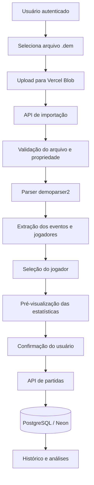

# Matchlytics 🎯

### Plataforma Web para Análise de Desempenho em Counter-Strike 2

O **Matchlytics** é uma plataforma web desenvolvida para auxiliar jogadores de Counter-Strike 2 (CS2) a registrar, organizar e analisar suas estatísticas de desempenho. A aplicação permite importar arquivos de demonstração de partidas (`.dem`) ou cadastrar partidas manualmente, reunindo informações individuais em um ambiente centralizado.

O objetivo é transformar os dados gerados durante as partidas em indicadores e visualizações que facilitem a compreensão do desempenho individual, permitindo acompanhar resultados, identificar padrões e observar o rendimento em diferentes mapas e lados da partida.

**Aplicação:** https://matchlytics.vercel.app

---

## 📌 Sobre o projeto

O Matchlytics foi desenvolvido como parte do **Projeto Integrador em Computação II (PJI240)** do curso de Engenharia de Computação da Universidade Virtual do Estado de São Paulo (UNIVESP).

A proposta surgiu a partir da identificação de uma dificuldade entre jogadores da comunidade de Counter-Strike 2: acompanhar e interpretar o próprio desempenho de forma organizada ao longo de diferentes partidas.

Embora as partidas produzam diversas informações estatísticas, a consulta isolada desses dados pode dificultar a identificação de padrões, pontos fortes e aspectos que necessitam de melhoria.

Diante desse cenário, o Matchlytics propõe centralizar essas informações e apresentá-las de maneira organizada, por meio de indicadores, gráficos e análises.

### Problema de pesquisa

Como uma plataforma web pode utilizar dados de partidas de Counter-Strike 2 para auxiliar jogadores na compreensão e no acompanhamento de seu desempenho competitivo?

### Objetivo geral

Desenvolver uma plataforma web para registro, organização e análise de dados de partidas de Counter-Strike 2, com o propósito de auxiliar os jogadores na compreensão e no acompanhamento de seu desempenho.

---

## ✨ Funcionalidades

### 👤 Autenticação e gerenciamento de usuários
- Cadastro de contas.
- Login e logout.
- Gerenciamento de sessões.
- Proteção de páginas e operações.
- Isolamento dos dados de cada usuário.

### 📥 Importação de partidas
- Envio de arquivos de demonstração `.dem`.
- Armazenamento temporário dos arquivos.
- Processamento das demonstrações utilizando `@laihoe/demoparser2`.
- Identificação dos jogadores participantes.
- Seleção do jogador que terá suas estatísticas registradas.
- Pré-visualização dos dados antes do salvamento.
- Validação de arquivos e tamanho de upload.

### ✍️ Cadastro manual
- Registro de partidas sem necessidade de importar uma demo.
- Inserção manual de informações estatísticas.
- Integração dos registros manuais ao histórico e às análises.

### 📊 Dashboard
- Visão geral do desempenho.
- Indicadores consolidados.
- Acompanhamento das estatísticas registradas.
- Visualização de informações relevantes das partidas.

### 🎮 Histórico e detalhes das partidas
- Listagem de partidas cadastradas.
- Consulta dos detalhes individuais.
- Visualização de Kills, Deaths, Assists e Headshots.
- Comparação de estatísticas entre CT e TR.
- Consulta dos resultados e informações de cada partida.

### 🗺️ Análise por mapas
- Consolidação das partidas por mapa.
- Quantidade de partidas disputadas.
- Win Rate.
- K/D.
- ADR.
- Score.
- Identificação padronizada dos mapas, independentemente de a partida ter sido importada por demo ou cadastrada manualmente.

### 📈 Análise de desempenho
- Organização de indicadores individuais.
- Visualizações gráficas.
- Comparação de resultados.
- Acompanhamento do histórico.
- Análise de desempenho entre os lados CT e TR.

### 💡 Insights
- Apresentação de informações consolidadas.
- Apoio à interpretação dos resultados.
- Identificação de padrões de desempenho a partir dos dados disponíveis.

---

## 📐 Indicadores de desempenho

O Matchlytics organiza diferentes indicadores para representar o desempenho individual nas partidas.

| Indicador | Descrição |
|---|---|
| Kills | Quantidade de eliminações realizadas pelo jogador. |
| Deaths | Quantidade de vezes que o jogador foi eliminado. |
| Assists | Quantidade de assistências registradas. |
| Headshots | Quantidade de eliminações realizadas com tiros na cabeça. |
| K/D | Relação entre eliminações e mortes. |
| HS% | Percentual de eliminações por Headshot em relação ao total de Kills. |
| Win Rate | Percentual de vitórias nas partidas consideradas. |
| ADR | Dano médio por round, conforme os dados e a forma de registro disponíveis. |
| Score | Indicador de desempenho calculado conforme a regra implementada no projeto. |

As estatísticas podem ser organizadas considerando o desempenho geral e a separação entre os lados Terrorista (TR) e Contra-Terrorista (CT).

**Observação:** ADR pode depender de informação registrada manualmente, conforme o recurso disponível. KAST não é tratado como uma métrica automaticamente extraída quando não há dados validados para seu cálculo. Valores não disponíveis não devem ser interpretados como zero.

---

## 🛠️ Tecnologias utilizadas

O projeto utiliza tecnologias modernas para desenvolvimento web, processamento de dados, armazenamento e testes.

| Tecnologia | Aplicação |
|---|---|
| Next.js | Framework principal da aplicação web |
| React | Construção da interface |
| TypeScript | Tipagem e desenvolvimento |
| Tailwind CSS | Estilização |
| shadcn/ui | Componentes de interface |
| PostgreSQL | Banco de dados relacional |
| Neon | Hospedagem do banco de dados |
| Drizzle ORM | Comunicação e gerenciamento de dados |
| Better Auth | Autenticação e gerenciamento de sessões |
| `@laihoe/demoparser2` | Processamento de arquivos de demonstração do CS2 |
| Recharts | Visualização gráfica de indicadores |
| Zod | Validação de dados |
| Vercel Blob | Armazenamento temporário de demos |
| Vercel | Hospedagem da aplicação |
| Vitest | Testes unitários |
| Playwright | Testes automatizados de interface e fluxos E2E |
| axe-core | Auditoria automatizada de acessibilidade |
| Git e GitHub | Versionamento e colaboração |
| GitHub Actions | Integração contínua e execução de testes |

---

## 🏗️ Arquitetura e funcionamento

A aplicação utiliza uma arquitetura web cliente-servidor, integrando interface, APIs, processamento de arquivos e banco de dados.

### Fluxo de importação de uma demo



### Componentes principais

**Frontend**

Responsável pela interface, navegação, formulários, apresentação das estatísticas e interação com o usuário.

**Backend**

Responsável pelas APIs, autenticação, validação dos dados, controle de acesso e processamento das operações.

**Processamento de demos**

Utiliza a biblioteca `@laihoe/demoparser2` para interpretar arquivos `.dem` e extrair informações dos eventos das partidas.

**Banco de dados**

O PostgreSQL armazena os usuários, partidas e informações estatísticas, utilizando Drizzle ORM como camada de acesso aos dados.

**Armazenamento temporário**

O Vercel Blob é utilizado no fluxo de upload das demonstrações. Os arquivos temporários são tratados conforme o processo de importação e limpeza implementado.

---

## 🗺️ Padronização dos mapas

O projeto implementa um mecanismo centralizado de normalização dos nomes dos mapas.

Essa funcionalidade evita que o mesmo mapa seja apresentado em grupos diferentes devido às diferenças entre o identificador técnico retornado pelo parser e o nome utilizado no cadastro manual.

Exemplos:

| Nome recebido | Identificação canônica | Nome apresentado |
|---|---|---|
| `de_mirage` | `mirage` | Mirage |
| `Mirage` | `mirage` | Mirage |
| `de_dust2` | `dust2` | Dust 2 |
| `Dust 2` | `dust2` | Dust 2 |
| `de_inferno` | `inferno` | Inferno |
| `Inferno` | `inferno` | Inferno |

A normalização é aplicada nos processos de importação, cadastro, edição e consolidação das estatísticas.

Dessa forma, partidas importadas por demo e cadastradas manualmente podem ser agrupadas corretamente.

---

## 🔐 Segurança e proteção dos dados

O Matchlytics possui mecanismos de proteção para garantir que cada usuário acesse somente suas próprias informações.

Entre os recursos implementados estão:

- Autenticação utilizando Better Auth.
- Proteção de rotas e operações autenticadas.
- Verificação da propriedade dos recursos.
- Validação dos arquivos enviados.
- Limite de tamanho para upload de demos.
- Separação dos dados por usuário.
- Armazenamento temporário de arquivos.
- Proteção de variáveis sensíveis por meio de variáveis de ambiente.
- Tratamento de erros sem exposição intencional de credenciais.

Os testes de segurança devem ser realizados preferencialmente em contas e ambientes isolados, sem utilizar credenciais ou dados de produção para operações destrutivas.

---

## ♿ Acessibilidade

A acessibilidade foi considerada durante o desenvolvimento da interface, utilizando recomendações das Web Content Accessibility Guidelines (WCAG) 2.2 como referência.

Foram implementados recursos como:

- Link para pular diretamente ao conteúdo principal.
- Estrutura semântica e landmarks.
- Hierarquia de títulos.
- Identificação acessível dos campos de formulário.
- Mensagens de validação e estados da interface.
- Indicadores visíveis de foco.
- Navegação por teclado.
- Contraste de cores.
- Tabelas com estrutura semântica.
- Alternativas textuais para informações apresentadas em gráficos.
- Adaptação da interface a diferentes tamanhos de tela.

A auditoria automatizada utiliza Playwright e axe-core, com projetos desktop e mobile.

A aprovação dos testes automatizados não representa, isoladamente, certificação de conformidade integral com WCAG 2.2. A avaliação também deve considerar testes manuais com teclado, leitor de tela e ampliação de conteúdo.

---

## 🧪 Testes e qualidade

O projeto utiliza diferentes ferramentas para verificar a qualidade e o funcionamento da aplicação.

### Testes unitários

Executados com Vitest, verificando funções responsáveis por:

- Processamento de dados.
- Cálculos estatísticos.
- Consolidação de indicadores.
- Normalização de mapas.
- Integridade dos dados.
- Regras de negócio.

### Testes End-to-End

Executados com Playwright para verificar fluxos de utilização, navegação e comportamento da interface.

### Testes de acessibilidade

Utilizam axe-core integrado ao Playwright para identificar violações automatizáveis de acessibilidade.

### Integração contínua

O GitHub Actions automatiza verificações do projeto, incluindo:

- Typecheck.
- Testes unitários.
- Build de produção.
- Instalação dos navegadores necessários.
- Testes E2E.
- Publicação de relatórios e traces quando aplicável.

### Executar as validações localmente

```bash
pnpm typecheck
pnpm test
pnpm build
pnpm test:e2e
```

Para instalar os navegadores utilizados pelo Playwright:

```bash
pnpm exec playwright install chromium webkit
```

Em ambientes Linux, podem ser necessárias dependências adicionais do sistema:

```bash
pnpm exec playwright install --with-deps chromium webkit
```

---

## 🚀 Como executar o projeto localmente

### Pré-requisitos

- Node.js 22 ou versão compatível com o projeto.
- pnpm 12.3.4 ou versão compatível.
- PostgreSQL ou uma instância de teste do Neon.
- Conta e configuração do Vercel Blob para utilizar a importação de demos.
- Git.

### 1. Clonar o repositório

```bash
git clone https://github.com/samszf/desenvolvimento-do-matchlytics.git
```

Acesse a pasta:

```bash
cd desenvolvimento-do-matchlytics
```

### 2. Instalar dependências

```bash
pnpm install
```

Para reproduzir a instalação utilizada no CI:

```bash
pnpm install --frozen-lockfile
```

### 3. Configurar as variáveis de ambiente

Crie um arquivo `.env.local` na raiz do projeto.

Configure as variáveis necessárias:

```env
DATABASE_URL="sua_string_de_conexao_postgresql"

BETTER_AUTH_SECRET="sua_chave_secreta_de_autenticacao"

BETTER_AUTH_URL="http://localhost:3000"

BLOB_READ_WRITE_TOKEN="seu_token_do_vercel_blob"
```

**Descrição das variáveis:**

| Variável | Finalidade |
|---|---|
| `DATABASE_URL` | Conexão com o PostgreSQL. |
| `BETTER_AUTH_SECRET` | Chave secreta utilizada pelo Better Auth. |
| `BETTER_AUTH_URL` | URL base da aplicação utilizada na autenticação. |
| `BLOB_READ_WRITE_TOKEN` | Credencial de acesso ao Vercel Blob. |

Os valores devem ser obtidos e configurados individualmente em seu ambiente.

Em produção, utilize:

```env
BETTER_AUTH_URL="https://matchlytics.vercel.app"
```

**Importante:**
- Nunca compartilhe o conteúdo de `.env.local`.
- Não envie credenciais para o GitHub.
- Utilize um banco isolado para desenvolvimento e testes.
- Confira as variáveis efetivamente utilizadas pelo código antes de executar a aplicação.
- Caso o projeto possua outras variáveis de ambiente, configure-as conforme os arquivos de configuração e integrações existentes.

### 4. Preparar o banco de dados

Configure o PostgreSQL e execute as migrations existentes do Drizzle utilizando o comando de migração definido nos scripts do projeto.

Antes de iniciar, confirme que a conexão com o banco está funcionando e que o schema foi aplicado.

### 5. Executar a aplicação

```bash
pnpm dev
```

A aplicação ficará disponível, por padrão, em:

```text
http://localhost:3000
```

---

## ☁️ Deploy e infraestrutura

O projeto utiliza serviços gerenciados para disponibilizar a aplicação e seus recursos.

| Serviço | Responsabilidade |
|---|---|
| Vercel | Hospedagem da aplicação Next.js |
| Neon | Banco de dados PostgreSQL |
| Vercel Blob | Armazenamento temporário das demos |
| GitHub | Repositório e versionamento |
| GitHub Actions | Automação dos testes e validações |

A configuração de produção deve utilizar variáveis de ambiente próprias e credenciais protegidas.

---

## 📚 Estrutura conceitual do projeto

O Matchlytics reúne os seguintes módulos funcionais:

```text
Matchlytics
│
├── Autenticação
│   ├── Cadastro
│   ├── Login
│   └── Sessões
│
├── Dashboard
│   └── Visão geral do desempenho
│
├── Partidas
│   ├── Cadastro manual
│   ├── Importação de demos
│   ├── Seleção de jogadores
│   ├── Histórico
│   └── Detalhes da partida
│
├── Análises
│   ├── Estatísticas gerais
│   ├── Comparação CT/TR
│   ├── Análise por mapas
│   └── Insights
│
└── Infraestrutura
    ├── APIs
    ├── PostgreSQL
    ├── Vercel Blob
    ├── Autenticação
    └── Testes automatizados
```

A estrutura acima representa os módulos funcionais da solução, não necessariamente a árvore física de diretórios do código-fonte.

---

## 🎯 Metodologia do Projeto Integrador

O desenvolvimento foi organizado com base nas etapas propostas pela UNIVESP para os Projetos Integradores: ouvir, criar e implementar.

### Ouvir

Foram realizadas conversas exploratórias com quatro jogadores da comunidade de Counter-Strike 2, utilizando Discord e WhatsApp, para identificar dificuldades relacionadas ao acompanhamento e à interpretação do desempenho individual.

Os relatos ajudaram a identificar a necessidade de centralizar informações estatísticas e facilitar a consulta aos resultados das partidas.

### Criar

As necessidades identificadas foram transformadas em requisitos funcionais e não funcionais. A partir deles, foram definidos os principais módulos, o fluxo de utilização, a arquitetura tecnológica e as interfaces da plataforma.

### Implementar

A solução foi desenvolvida incrementalmente, com implementação das funcionalidades, testes técnicos, correções de inconsistências e melhorias de acessibilidade.

Os feedbacks dos participantes também contribuíram para identificar possibilidades de evolução, como resumos compartilháveis, estatísticas recreativas, métricas competitivas avançadas e recursos de análise tática.

---

## 🔭 Possibilidades de evolução
